<p><a href="https://www.nxdpro.com/?utm_source=github&utm_medium=profile">
  <picture>
    <source media="(max-width: 600px) and (prefers-color-scheme: dark)" srcset="assets/banner-mobile-dark.svg">
    <source media="(max-width: 600px)" srcset="assets/banner-mobile-light.svg">
    <source media="(prefers-color-scheme: dark)" srcset="assets/banner-dark.svg">
    
  </picture>
</a></p>

**NXDPRO Solutions** is a web and e-commerce studio in Limassol, Cyprus. Since 2003 we have designed, built and looked after websites, online shops and custom software for businesses in Cyprus and Greece. We open-source the tools we build for our own work, starting with [JourneyGuard](https://github.com/nxdpro/journeyguard).

**[Free e-shop check](mailto:info@nxdpro.com?subject=Free%20e-shop%20check)** · **[info@nxdpro.com](mailto:info@nxdpro.com)** · **[nxdpro.com](https://www.nxdpro.com/?utm_source=github&utm_medium=profile)** · **[Facebook](https://www.facebook.com/nxdpro.solutions)** · **[Ελληνικά ↓](#στα-ελληνικά)**

## What we do

| Service | What it covers |
|:---|:---|
| **Websites & e-shops** | Websites you can update yourself, and e-shops on WooCommerce, Shopify or built to measure, set up for the Cypriot and Greek market |
| **Custom business systems** | Booking, client portals, CRMs, dashboards, mobile apps and PWAs, and integrations between the tools you already use |
| **Digital marketing** | SEO, Google, Meta and TikTok ads, social media, email and SMS campaigns, analytics and conversion optimisation |
| **Brand & design** | Logos and brand identity, banners, presentations and packaging |
| **Care & security** | Maintenance and backups, hosting, domains and business email, security audits, SSL and firewalls |

## JourneyGuard

<p><a href="https://github.com/nxdpro/journeyguard">
  <picture>
    <source media="(max-width: 600px) and (prefers-color-scheme: dark)" srcset="assets/journeyguard-mobile-dark.svg">
    <source media="(max-width: 600px)" srcset="assets/journeyguard-mobile-light.svg">
    <source media="(prefers-color-scheme: dark)" srcset="assets/journeyguard-dark.svg">
    
  </picture>
</a></p>

**Your website can be "up" while customers can't buy, sign up or contact you.** [JourneyGuard](https://github.com/nxdpro/journeyguard) walks through checkout and forms like a real customer and tells you, in plain English, Greek or Spanish, what broke and the likely cause. Free, open source (MIT) and runs on your own server.

```bash
# Check your own shop once: nothing is bought, no message is sent
docker run --rm ghcr.io/nxdpro/journeyguard check https://your-shop.com
```

**[Repository](https://github.com/nxdpro/journeyguard)** · **[Quick start](https://github.com/nxdpro/journeyguard#quick-start)** · **[Releases](https://github.com/nxdpro/journeyguard/releases)** · **[Ελληνικά](https://github.com/nxdpro/journeyguard/blob/main/README.el.md)**

## How we work

- **We maintain what we build.** A launch is the start, not the end.
- **We measure instead of guessing.** We test checkout, forms and key pages the way customers use them, and we built JourneyGuard to keep doing it.
- **Security and privacy by default.** HTTPS, backups, least-privilege access and GDPR-aware setups from day one.

## Tools we use


## Work with us

Need an e-shop, a custom system built around how your business actually works, or someone to fix what JourneyGuard found?

**Free e-shop check:** send us your shop's address. We go through it like a customer (product, cart, checkout, payment methods, contact form, SSL) and email you what we find, free and without obligation.

[](mailto:info@nxdpro.com?subject=Free%20e-shop%20check)
[](mailto:info@nxdpro.com)
[](https://www.nxdpro.com/?utm_source=github&utm_medium=profile)
[](https://www.facebook.com/nxdpro.solutions)

---

## Στα ελληνικά

Η **NXDPRO Solutions** είναι εταιρεία ιστοσελίδων και eShop στη Λεμεσό. Από το 2003 σχεδιάζουμε, κατασκευάζουμε και συντηρούμε ιστοσελίδες, eShop και εξειδικευμένα συστήματα για επιχειρήσεις σε Κύπρο και Ελλάδα, και φροντίζουμε να λειτουργούν σωστά και μετά την παράδοση.

| Υπηρεσία | Τι περιλαμβάνει |
|:---|:---|
| **Ιστοσελίδες και eShop** | Ιστοσελίδες που ενημερώνετε μόνοι σας και eShop σε WooCommerce, Shopify ή κατά παραγγελία, προσαρμοσμένα στην αγορά της Κύπρου και της Ελλάδας |
| **Εξειδικευμένα συστήματα** | Κρατήσεις, portals πελατών, CRM, dashboards, εφαρμογές για κινητά και PWA, και διασύνδεση με τα εργαλεία που ήδη χρησιμοποιείτε |
| **Ψηφιακό marketing** | SEO, διαφημίσεις σε Google, Meta και TikTok, social media, καμπάνιες email και SMS, analytics και βελτιστοποίηση μετατροπών |
| **Σχεδιασμός και branding** | Λογότυπα και εταιρική ταυτότητα, banners, παρουσιάσεις και συσκευασίες |
| **Υποστήριξη και ασφάλεια** | Συντήρηση και backup, φιλοξενία, domains και εταιρικά email, έλεγχοι ασφαλείας, SSL και firewall |

Το [JourneyGuard](https://github.com/nxdpro/journeyguard/blob/main/README.el.md) είναι το δωρεάν εργαλείο μας ανοιχτού κώδικα: ελέγχει, όπως ένας πραγματικός πελάτης, αν οι πελάτες σας μπορούν να αγοράσουν από το eShop σας και να επικοινωνήσουν μαζί σας, και σας ειδοποιεί στα ελληνικά μόλις κάτι χαλάσει, μαζί με την πιθανή αιτία.

**Πώς δουλεύουμε:** συντηρούμε ό,τι φτιάχνουμε, ελέγχουμε το ταμείο και τις φόρμες όπως τα χρησιμοποιούν οι πελάτες σας, και ξεκινάμε από την πρώτη μέρα με HTTPS, backup και ρυθμίσεις σύμφωνες με τον GDPR.

**Δωρεάν έλεγχος eShop:** στείλτε μας τη διεύθυνση του eShop σας. Το περνάμε όπως ένας πελάτης (προϊόν, καλάθι, ταμείο, τρόποι πληρωμής, φόρμα επικοινωνίας, SSL) και σας στέλνουμε τι βρήκαμε, δωρεάν και χωρίς δέσμευση.

[](mailto:info@nxdpro.com?subject=%CE%94%CF%89%CF%81%CE%B5%CE%AC%CE%BD%20%CE%AD%CE%BB%CE%B5%CE%B3%CF%87%CE%BF%CF%82%20eShop)
[](mailto:info@nxdpro.com)
[](https://www.nxdpro.com/?utm_source=github&utm_medium=profile-el)
[](https://www.facebook.com/nxdpro.solutions)
