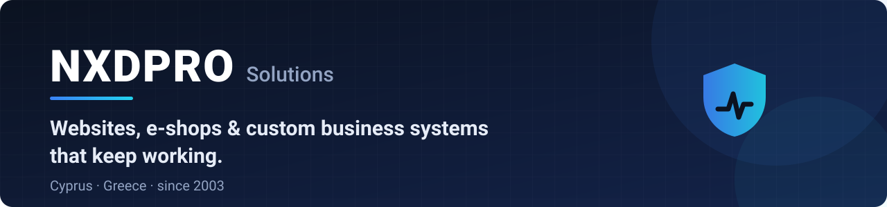
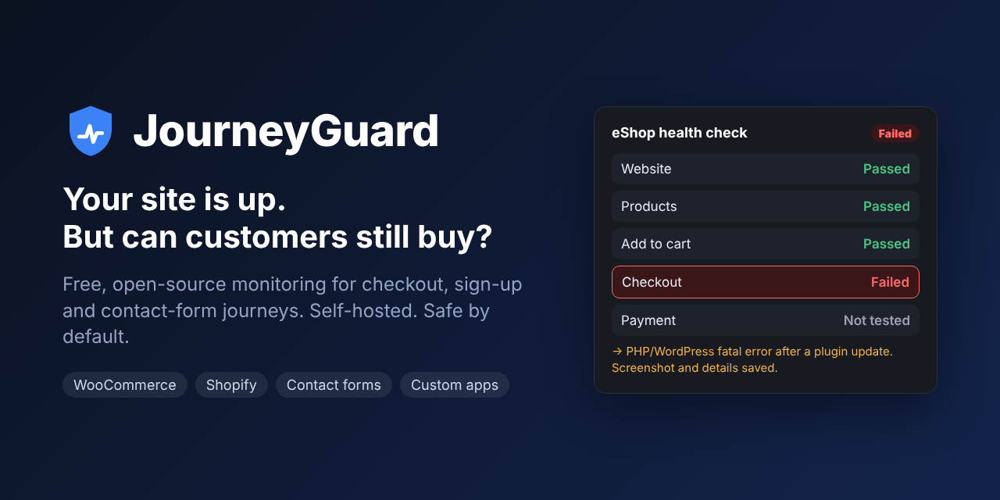

<a href="https://www.nxdpro.com"></a>

**NXDPRO Solutions** is a web and e-commerce studio in Limassol, Cyprus. Since 2003 we have designed, built and looked after websites, online shops and custom software for businesses in Cyprus and Greece, and we build and run platforms of our own.

We open-source the tools we build for our own work, starting with JourneyGuard.

🇬🇷 🇨🇾 [Διαβάστε στα ελληνικά ↓](#στα-ελληνικά)

## 🛡️ JourneyGuard

<a href="https://github.com/nxdpro/journeyguard"></a>

**Your website can be "up" while customers can't buy, sign up or contact you.** [JourneyGuard](https://github.com/nxdpro/journeyguard) walks through checkout and forms like a real customer and tells you, in plain English or Greek, the moment a journey breaks. Free, self-hosted, MIT-licensed.

```bash
# Check your own shop once: nothing is bought, no message is sent
docker run --rm ghcr.io/nxdpro/journeyguard check https://your-shop.com
```

## What we build

- 🛒 **E-shops that sell** — WooCommerce, Shopify and custom stores, set up for the Cypriot and Greek market
- ⚙️ **Custom business systems** — booking, client portals, CRMs, dashboards, and integrations between the tools you already use
- 🌐 **Websites and apps** — fast, accessible websites you can update yourself; mobile apps and PWAs
- 🔒 **Keeping it running** — monitoring, maintenance, security audits, hosting and backups

## Platforms we built and run

| Platform | What it is |
|---|---|
| 🏷️ **[BuySellCy](https://www.buysellcy.com/)** | Marketplace for buying and selling in Cyprus, with 12K+ active listings |
| 🏢 **[CypInfo](https://cypinfo.com/)** | AI-powered business directory for Cyprus with 3,400+ verified listings · [case study](https://www.nxdpro.com/en/case-studies/cypinfo) |
| 🔎 **[SEO Auditor Pro](https://seoauditor.pro/)** | SEO audit extension for Chrome: 81 checks that run privately in your browser · [case study](https://www.nxdpro.com/en/case-studies/seo-auditor) |
| 🚗 **[Car For Sale Cyprus](https://www.carforsalecyprus.com/)** | Cars for sale across Cyprus |
| 🏠 **[BuyRent.com.cy](https://buyrent.com.cy/)** | Property to buy and rent in Cyprus |

## How we work

- **We maintain what we build.** A launch is the start, not the end.
- **We measure, not guess.** We test checkout, forms and key pages the way customers use them, and we built JourneyGuard to keep doing it.
- **Security and privacy by default.** HTTPS, backups, least-privilege access and GDPR-aware setups from day one.

## Tools we use


## Work with us

Need an e-shop, a custom system built around how your business actually works, or someone to fix what JourneyGuard found? **We check your e-shop for free** and tell you what we find.

**[nxdpro.com](https://www.nxdpro.com/?utm_source=github&utm_medium=profile)** · **[info@nxdpro.com](mailto:info@nxdpro.com)** · **[Facebook](https://www.facebook.com/nxdpro.solutions)**

---

## Στα ελληνικά

Από το 2003 σχεδιάζουμε, κατασκευάζουμε και συντηρούμε ιστοσελίδες, eShop και εξειδικευμένα συστήματα για επιχειρήσεις σε Κύπρο και Ελλάδα, και φροντίζουμε να λειτουργούν σωστά και μετά την παράδοση.

- 🛒 **eShop που πουλάνε**: WooCommerce, Shopify και custom καταστήματα, προσαρμοσμένα στην αγορά της Κύπρου και της Ελλάδας
- ⚙️ **Εξειδικευμένα συστήματα**: κρατήσεις, portals πελατών, CRM, dashboards και διασύνδεση με τα εργαλεία που ήδη χρησιμοποιείτε
- 🌐 **Ιστοσελίδες και εφαρμογές**: γρήγορες, προσβάσιμες ιστοσελίδες που ενημερώνετε μόνοι σας, εφαρμογές για κινητά και PWA
- 🔒 **Συνεχής λειτουργία**: παρακολούθηση, συντήρηση, έλεγχοι ασφαλείας, φιλοξενία και backup

Έχουμε δημιουργήσει και λειτουργούμε πλατφόρμες όπως τα [BuySellCy](https://www.buysellcy.com/), [CypInfo](https://cypinfo.com/), [SEO Auditor Pro](https://seoauditor.pro/), [Car For Sale Cyprus](https://www.carforsalecyprus.com/) και [BuyRent.com.cy](https://buyrent.com.cy/).

Το [JourneyGuard](https://github.com/nxdpro/journeyguard/blob/main/README.el.md) είναι το δωρεάν εργαλείο μας που ελέγχει, όπως ένας πραγματικός πελάτης, αν μπορούν να αγοράσουν από το eShop σας και να επικοινωνήσουν μαζί σας, και σας ειδοποιεί στα ελληνικά μόλις κάτι χαλάσει.

**Ελέγχουμε δωρεάν το eShop σας.** Γράψτε μας στο **[info@nxdpro.com](mailto:info@nxdpro.com)** ή επισκεφθείτε το **[nxdpro.com](https://www.nxdpro.com/?utm_source=github&utm_medium=profile-el)**.
